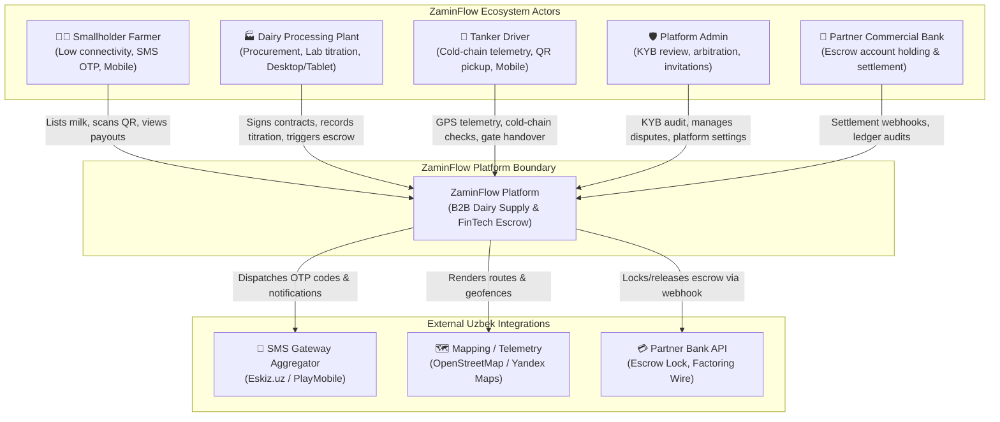
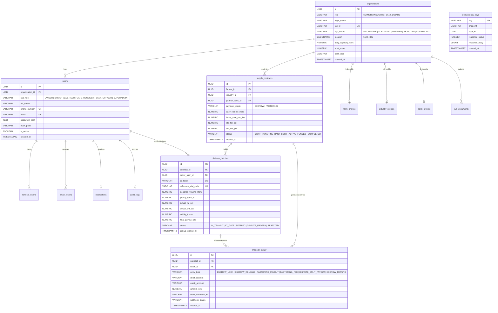

# ZaminFlow System Architecture Overview & Inventory

**Document ID:** `DOC-ARCH-001`  
**Phase:** Phase 0 (Discovery & Inventory)  
**Status:** Baseline Complete  
**Date:** 2026-11-07  
**Review Board:** Principal Software Architect, Staff Backend Engineer, Security Architect, Staff Frontend Engineer, Principal Product Designer, Accessibility & Localization Specialist, SRE / DevOps Engineer, Database Engineer  

---

## 1. Executive Summary & Inventory

ZaminFlow is a specialized B2B AgriTech and FinTech platform tailored for the dairy supply ecosystem of Uzbekistan. It orchestrates commercial milk transactions between smallholder farmers, milk-tanker logistics drivers, commercial dairy processing plants, partner escrow banks, and regulatory administrators.

### Core Inventory Breakdown
| Component | Technology | Version | Location / Port | Description |
| :--- | :--- | :--- | :--- | :--- |
| **Frontend** | Next.js (App Router), React, Tailwind CSS | Next 15.0.2 / React 18.3.1 | `frontend/` (Port 3000) | Public landing, live telemetry (#stats), 4 role dashboards (`/dashboard/*`), SSR & client components |
| **Backend API** | FastAPI, SQLAlchemy 2.0 (asyncio), Pydantic v2 | Python 3.12, FastAPI 0.115 | `backend/` (Port 8000) | Modular monolith v3.0, 51 endpoints, JWT + Cookie auth, asyncpg |
| **Database** | PostgreSQL 16 + PostGIS 3.4 | PostGIS 16-3.4-alpine | Container `dairy_db` (Port 5432) | Relational database, spatial geometry, GIST indexing, 17 tables |
| **Edge Proxy** | Caddy v2 | 2-alpine | Container `dairy_caddy` (Port 80/443) | Auto-TLS reverse proxy routing `/api/*` to FastAPI and `/` to Next.js |
| **Testing** | Pytest, unittest, Node TAP | Pytest 9.2, Node 20 | `backend/tests/`, `qa/automation/` | 6 unit tests, 14 integration tests, 4 redirect suite tests |

---

## 2. C4 Architecture Diagrams

### 2.1 C4 Level 1: System Context Diagram


---

### 2.2 C4 Level 2: Container Diagram
```mermaid
flowchart TB
    subgraph ClientDevices ["Client Devices & Browsers"]
        MobileBrowser["Mobile Browser (Chrome/Safari)<br/>Farmer & Driver"]
        DesktopBrowser["Desktop Browser<br/>Dairy & Admin"]
    end

    subgraph EdgeTier ["Edge & Ingress Tier"]
        CaddyProxy["Caddy 2 Reverse Proxy<br/>(Port 80 / 443)<br/>TLS termination, gzip/zstd, path routing"]
    end

    subgraph ApplicationTier ["Application Tier (Docker Containers)"]
        NextJS["Next.js 15 Frontend<br/>(Port 3000)<br/>App Router, React Server Components, SSR"]
        NextProxy["Next.js Route Proxy<br/>(/api/[...path])<br/>Auth forwarding, edge rate limiting"]
        FastAPI["FastAPI Modular Monolith v3.0<br/>(Port 8000)<br/>Python 3.12, Uvicorn, AsyncIO, 51 Endpoints"]
        Scheduler["APScheduler Background Engine<br/>Nightly bank settlement, token cleanup"]
    end

    subgraph DataTier ["Data Tier (PostgreSQL 16)"]
        PostgresDB[("PostgreSQL 16 + PostGIS 3.4<br/>(Port 5432)<br/>Relational ledger, spatial GIS, JSONB audit")]
    end

    MobileBrowser -->|HTTPS| CaddyProxy
    DesktopBrowser -->|HTTPS| CaddyProxy

    CaddyProxy -->|Routes /* (UI)| NextJS
    CaddyProxy -->|Routes /api/* (Direct API)| FastAPI

    NextJS -.->|Optional SSR / API Calls| NextProxy
    NextProxy -->|Internal HTTP| FastAPI

    FastAPI -->|Async connection pool (asyncpg)| PostgresDB
    FastAPI --> Scheduler
```

---

### 2.3 C4 Level 3: FastAPI Backend Component Diagram

```mermaid
flowchart TB
    subgraph FastAPIApp ["FastAPI Application (Modular Monolith)"]
        RouterLayer["API Router Layer (prefix /api/v1)"]
        
        subgraph Modules ["Domain Service Modules"]
            AuthMod["auth_rbac<br/>(JWT, SMS OTP, Argond2id, RBAC guards)"]
            ProfileMod["profiles_kyb<br/>(Farm/Industry profiles, KYB documents)"]
            ContractsMod["smart_contracts<br/>(Milk supply terms, digital signatures)"]
            BatchesMod["qr_logistics<br/>(QR handshake, GPS logging, cold-chain)"]
            EscrowMod["escrow_ledger<br/>(Double-entry ledger, bank escrow, payouts)"]
            DisputesMod["disputes<br/>(Arbitration, split settlements)"]
            MetricsMod["metrics<br/>(Live statistics, SSE stream, WS ticker)"]
            NotifMod["notifications<br/>(In-app alerts, read status)"]
            TrustMod["trust_rating<br/>(Farmer & Dairy scoring engine)"]
        end

        subgraph CoreLayer ["Core Infrastructure"]
            SecurityCore["Security (Password hash, JWT tokens, CSRF)"]
            DatabaseCore["Database (AsyncSessionLocal, pool_size=20)"]
            IdempotencyCore["Idempotency (Rule 03 replay protection)"]
            MailerCore["Mailer (Async SMTP / Mail mock)"]
        end
    end

    RouterLayer --> AuthMod
    RouterLayer --> ProfileMod
    RouterLayer --> ContractsMod
    RouterLayer --> BatchesMod
    RouterLayer --> EscrowMod
    RouterLayer --> DisputesMod
    RouterLayer --> MetricsMod
    RouterLayer --> NotifMod
    RouterLayer --> TrustMod

    AuthMod --> SecurityCore
    EscrowMod --> IdempotencyCore
    AllModules --> DatabaseCore
```


---

## 3. Database Entity Relationship Diagram (ERD)



---

## 4. Data-Flow Diagram (PII & Financial Data)

```mermaid
flowchart LR
    subgraph PublicUntrusted ["Untrusted Boundary"]
        BrowserUser["User Browser / Mobile Device"]
    end

    subgraph IngressBoundary ["TLS / Ingress Boundary"]
        CaddyEdge["Caddy TLS Termination"]
    end

    subgraph InternalServices ["Internal Trust Zone"]
        NextProxySvc["Next.js Rate Limiter Proxy"]
        FastAPIAuth["FastAPI Auth Module (Argon2id / Passlib)"]
        FastAPILedger["FastAPI Double-Entry Escrow Engine"]
    end

    subgraph PersistentStorage ["Storage Tier (Encrypted at Rest)"]
        PostgresPII[("PostgreSQL: Users Table<br/>(Pass Hash, Phone, Email, TIN, Passports)")]
        PostgresFin[("PostgreSQL: Financial Ledger<br/>(Escrow Lock, Amounts UZS, Bank IBAN)")]
        LocalDocs[("Local Secure Volume<br/>KYB Documents PDF/JPG (<=5MB)")]
    end

    BrowserUser -->|1. Credentials (Email/Phone + Pass)| CaddyEdge
    CaddyEdge -->|2. Proxy Request| NextProxySvc
    NextProxySvc -->|3. Forwarded IP + Headers| FastAPIAuth
    FastAPIAuth -->|4. Argon2id Hash Verify| PostgresPII
    FastAPIAuth -->|5. Issue Signed JWT Access Token & HTTP Cookie| BrowserUser

    BrowserUser -->|6. Verified Titration Input (Lab Tech)| FastAPILedger
    FastAPILedger -->|7. Calculate Quality Formula & Deduct Escrow| PostgresFin
    FastAPILedger -->|8. Webhook Notification to Partner Bank| BrowserUser
```

---

## 5. First Risk Ranking (Top Risks Ranked by Severity & Likelihood)

| Rank | Risk ID | Lens | Title / Description | Severity | Likelihood | Impact & Evidence |
| :---: | :---: | :---: | :--- | :---: | :---: | :--- |
| **1** | **RSK-001** | Security | **Client-side JWT storage in `localStorage` exposing tokens to XSS** | **High** | High | `frontend/src/lib/api.ts` line 18 reads `localStorage.getItem("zaminflow_jwt")`. If any malicious script or 3rd-party JS executes, JWT tokens are stolen. Tokens must be stored exclusively in `HttpOnly; Secure; SameSite=Strict` cookies. |
| **2** | **RSK-002** | Security | **Caddy edge bypasses Next.js rate limiting for API routes** | **High** | High | `Caddyfile` lines 8-10 routes `/api/*` directly to `backend:8000`. The edge rate limiter in `frontend/src/app/api/[...path]/route.ts` is never invoked in production through Caddy. Rate limiting must be in FastAPI middleware or Caddy. |
| **3** | **RSK-003** | Database | **Alembic migration 0002 has an empty `downgrade()` implementation** | **High** | Med | `0002_onboarding_gating.py` line 184 has `def downgrade(): pass`. Any failed migration rollback leaves schema in corrupted state. |
| **4** | **RSK-004** | Compliance | **Legal uncertainty regarding Uzbek Personal Data Law ZRU-547** | **High** | High | Law ZRU-547 Article 27¹ mandates storing citizens' data within Uzbekistan. If hosted outside UZ without local DB, State Inspectorate can block the domain. |
| **5** | **RSK-005** | Reliability | **Missing outbox pattern and webhook retry backoff for bank ledger** | **Med** | High | `financial_ledger.webhook_status` can be marked `FAILED_RETRY` without a persistent async background worker to safely redeliver with exponential backoff. |
| **6** | **RSK-006** | Data Integrity | **Floating-point risk in money arithmetic if not strictly Decimal** | **Med** | Low | Database uses `NUMERIC(19, 4)`, but Python service models must use `Decimal` throughout. Float coercion would introduce rounding errors in UZS. |
| **7** | **RSK-007** | Operations | **Missing persistent WAL archiving and disaster recovery restore script** | **Med** | Med | No automated off-site WAL shipping. A disk failure in `pgdata` docker volume could cause permanent data loss. |
| **8** | **RSK-008** | Architecture | **Duplicate legacy prototype routes compiled into Next.js bundle** | **Low** | High | Routes under `(field)` and `(portal)` (`/farmer/profile`, `/industry/dashboard`) are redirected in middleware but still bundled, inflating JS bundle size by $>150\text{kB}$. |
| **9** | **RSK-009** | Accessibility | **Live statistics charts missing full keyboard navigation & text alternatives** | **Low** | Med | SVG price charts in `ActiveTradeMetrics.tsx` require accessible tabular alternative summaries for screen readers (WCAG 2.2 AA). |
| **10** | **RSK-010** | Localization | **Hard-coded English strings across role dashboards and error toasts** | **Low** | High | Dashboards contain hard-coded English literals without `en/ru/uz` catalog bindings, impeding adoption among Uzbek-speaking farmers. |
