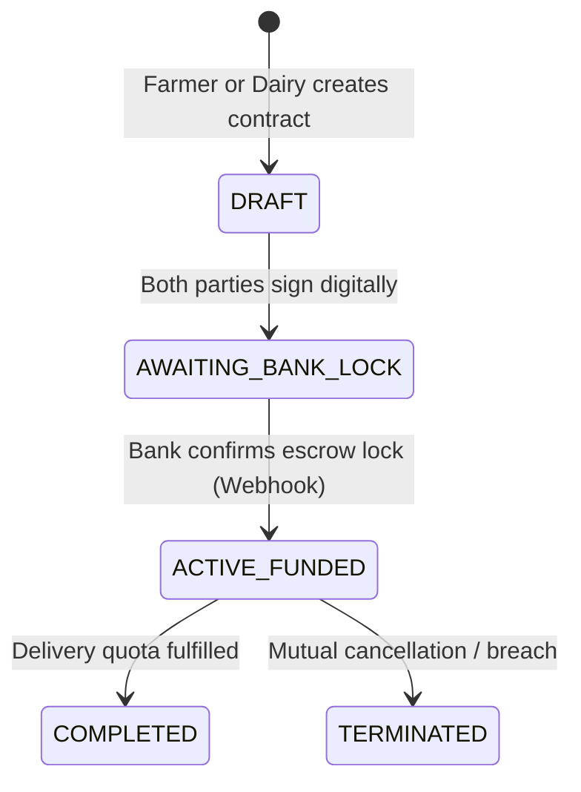
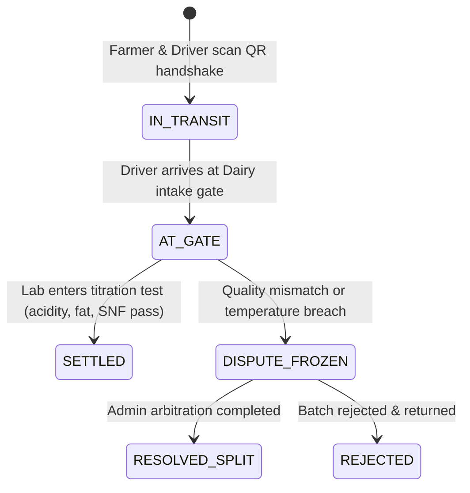

# ZaminFlow Domain & Data Model Specification

**Document ID:** `DOC-DAT-001`  
**Database:** PostgreSQL 16 with PostGIS 3.4  
**ORM:** SQLAlchemy 2.0 (asyncio) with asyncpg  

---

## 1. Domain Entities & State Machines

### 1.1 Supply Contract Lifecycle (`supply_contracts`)
A legally binding commercial agreement between a Farmer, a Dairy Industry, and a Partner Escrow Bank.

**State Invariants:**
- `daily_volume_liters` $> 0$
- `base_price_per_liter` $> 0$
- Escrow lock cannot be triggered until both `farmer_signed_at` and `industry_signed_at` are non-null.

---

### 1.2 Delivery Batch Lifecycle (`delivery_batches`)
Represents an individual physical collection and milk transport instance.

**State Invariants:**
- `pickup_temp_c` $\le 8.00^\circ\text{C}$ (Strict cold-chain pickup threshold).
- `reference_vial_code` is unique across all batches for physical lab sample traceability.
- Once status reaches `SETTLED`, escrow release cannot be executed a second time (idempotency key & ledger check).

---

### 1.3 Quality Pricing Matrix & Titration Formula
The milk price adjustment formula implemented in `backend/app/modules/smart_contracts/service.py`:

$$\text{Adjusted Price} = \text{Base Price} \times \left[ 1 + \alpha \left( \frac{\text{Actual Fat} - \text{Std Fat}}{\text{Std Fat}} \right) + \beta \left( \frac{\text{Actual SNF} - \text{Std SNF}}{\text{Std SNF}} \right) \right]$$

- Standard Fat: $3.60\%$, $\alpha = 0.1500$
- Standard SNF: $8.50\%$, $\beta = 0.1000$
- Acidity Threshold: $\le 18.0^\circ\text{T}$ (Turner). Batches $> 18.0^\circ\text{T}$ or containing antibiotics trigger immediate rejection.

---

## 2. PostgreSQL 16 Schema Specification

### 2.1 Core Tables Summary
1. `organizations`: Root tenant entity (FARMER, INDUSTRY, BANK, ADMIN). Holds PostGIS `GEOGRAPHY(POINT, 4326)` coordinates, KYB status, and daily capacity.
2. `users`: Identity and access record. Linked to an organization, role, and sub_role (OWNER, DRIVER, LAB_TECH, GATE_RECEIVER, BANK_OFFICER, SUPERADMIN).
3. `supply_contracts`: Contract terms, payment mode (ESCROW / FACTORING), pricing coefficients.
4. `delivery_batches`: Physical milk collection, declared volume, lab verified volume, temperature, and arbitration fields.
5. `financial_ledger`: Double-entry append-only accounting ledger.
6. `idempotency_keys`: Rule 03 replay and concurrent write protection.
7. `audit_logs`: Immutable JSONB operational log.
8. `login_attempts`: Brute-force tracking table.

### 2.2 Indexing Strategy
- **Spatial:** `idx_organizations_location` on `organizations (location)` using `GIST` for fast radius queries ($\le 50\text{km}$ farmer-dairy matchmaking).
- **Composite State:** `idx_delivery_batches_contract` on `(contract_id, status)` for fast active batch filtering.
- **Unique Lowercase Email:** `uq_users_email_lower` on `lower(email)` preventing duplicate registrations with varying capitalization.
