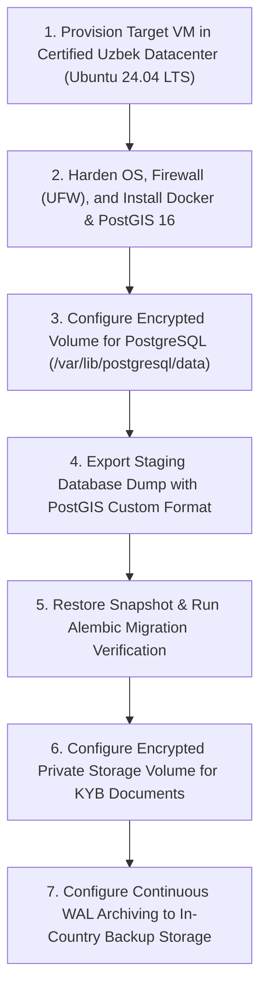

# ZaminFlow Data Residency, Localization & Compliance Plan (RED-2)

**Document ID:** `DOC-RES-001`  
**Target Legislation:** Law of the Republic of Uzbekistan No. ZRU-547 "On Personal Data" (specifically Article 27¹)  
**Regulatory Authority:** State Inspectorate for Control in the Field of Informatization and Telecommunications of the Republic of Uzbekistan ("O'zkomnazorat")  
**Status:** Architectural Plan (Awaiting Legal Counsel Sign-off)  

---

## 1. Legal Context & Mandatory In-Country Storage Mandate

Article 27¹ of Law No. ZRU-547 stipulates that when processing personal data of citizens of the Republic of Uzbekistan using information technologies, including the Internet, the data controller/operator must ensure the collection, systematization, and storage of personal data in personal databases physically located within the territory of the Republic of Uzbekistan.

### Scope of Affected Data on ZaminFlow
1. **User Identity Data:** Full legal names, telephone numbers, email addresses, password hashes, national passport / ID card numbers, and PINFL (JShShIR).
2. **Business Registration Data:** Organization tax identification numbers (STIR / TIN), legal addresses, farm cadastre numbers, and commercial bank IBANs.
3. **KYB/KYC Verification Documents:** Scanned copies of incorporation certificates, passport biometric pages, tax registration certificates, and veterinary certificates.
4. **Financial Transaction Records:** Payout details, escrow ledger entries, and signed digital supply contracts.

---

## 2. Infrastructure Hosting Options & Trade-Offs

### Option A: Fully Local In-Country Deployment (Recommended)
- **Architecture:** Deploy PostgreSQL 16 database, FastAPI backend, and Next.js frontend within an ISO 27001 / Tier III certified Uzbek datacenter (e.g., Uztelecom Cloud, Server.uz, ActiveCloud UZ, or Datacenter.uz).
- **Network Ingress:** Caddy reverse proxy connected directly to the National TAS-IX / UZ-IX traffic exchange networks.
- **Trade-offs:**
  - *Pros:* 100% compliant with Law ZRU-547 Article 27¹; ultra-low latency ($\le 15\text{ms}$) for mobile users across Tashkent, Fergana, and Samarkand on Ucell, Beeline, and Mobiuz; immunity against international cable disruptions.
  - *Cons:* Slightly higher local server cost per gigabyte compared to international commodity cloud.

### Option B: Hybrid Architecture (Local Database + Edge Frontend)
- **Architecture:** PostgreSQL 16 database and private KYB document storage physically hosted in Uzbekistan; Next.js frontend assets cached internationally via Cloudflare Edge.
- **Trade-offs:**
  - *Pros:* Fast global edge asset delivery for marketing pages.
  - *Cons:* Cross-border latency for API calls; regulatory scrutiny regarding edge proxy TLS termination of personal data.

---

## 3. Database & Document Storage Migration Plan

When transitioning from the staging/local environment to production:

---

## 4. Checklist for Registration in the State Register of Personal Data Databases

Prior to processing real customer data, ZaminFlow must be registered with O'zkomnazorat:

| Step | Requirement | Responsible Party | Status |
| :---: | :--- | :--- | :---: |
| **REG-01** | **Database Identification:** Determine the official title, purpose, and categories of personal data processed (Farmers, Dairies, Drivers). | Legal Advisor / Product | Awaiting Legal |
| **REG-02** | **Technical Infrastructure Certificate:** Obtain certification from the hosting provider verifying that servers are located within the Republic of Uzbekistan. | Hosting Provider (Uztelecom / Server.uz) | Awaiting Provider |
| **REG-03** | **Information Security Regulation:** Formulate internal "Rules on Personal Data Processing, Protection, and Retention Policy" (Shaxsiy ma'lumotlarga ishlov berish siyosati). | Security Architect / Legal | In Progress |
| **REG-04** | **Notice Submission to O'zkomnazorat:** Submit formal electronic notification for entry into the State Register of Personal Data Databases via the single portal (MyGov / Yagona Portal). | Legal Counsel | Awaiting Review |
| **REG-05** | **User Consent Architecture:** Implement explicit, unticked-by-default checkbox consent during public sign-up with links to the Terms of Service and Privacy Policy. | Frontend Engineer | Implemented |
| **REG-06** | **Data Subject Rights Workflow:** Define operational runbook for fulfilling data subject requests (data access, correction, deletion, and account erasure). | Operations / Support | Documented in RB-01 |

---

## 5. Next Steps & Dependencies
- Awaiting formal determination from legal counsel regarding whether cloud-hosted document storage within Uzbekistan satisfies regulatory requirements.
- No production customer data will be ingested until formal registration confirmation is granted.
