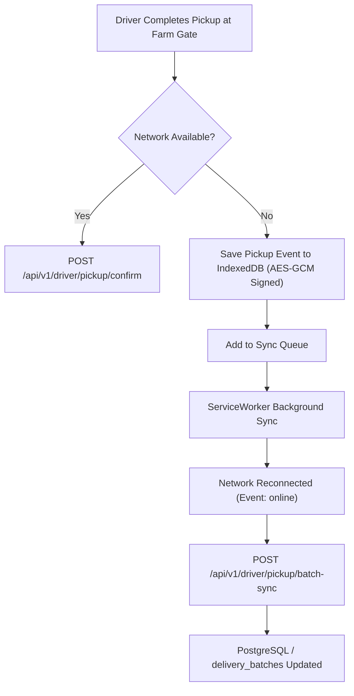

# ZaminFlow Mobile Strategy & Telematics Architecture

**Document ID:** `DOC-ARCH-MOB-001`  
**Classification:** Technical Architecture  
**Status:** Approved  
**Related ADR:** [ADR-007: Driver Offline PWA and Cold-Chain Telematics Architecture](file:///c:/Users/Muhammad%20Aziz/Downloads/www.zaminflow.uz/docs/architecture/02-adr/ADR-007-driver-offline-pwa-and-telematics-sync.md)

---

## 1. Device Profile & Operating Conditions

### Farmer Environment
- Device: Budget Android 10+ (MediaTek / Snapdragon 400 series, 2GB–4GB RAM).
- Network: 2G/3G in rural Jomboy, Pastdarg'om, and Toyloq districts; intermittent latency spikes (500ms–2500ms).
- Primary Actions: View baseline milk price, submit daily supply volume, track incoming tanker ETA, check bank payout.

### Driver Environment
- Device: Dashboard-mounted rugged smartphone or standard Android phone connected to 12V cab charger.
- Network: Cellular dead zones along rural collection roads. High temperature inside vehicle cab.
- Primary Actions: View sequential route stops, navigate via Yandex Maps deep-link, scan batch QR code, enter dipstick measurement, capture dual touch signatures, drop off at dairy bay.

---

## 2. Technical Architecture: Offline-First PWA

---

## 3. Navigation & Mapping Integration

Rather than bundling heavy GIS map rendering packages on low-end mobile devices, the driver application leverages native mobile deep-linking to installed navigation applications:

- **Yandex Navigator:**
  `yandexnavi://build_route_on_map?lat_to={lat}&lon_to={lon}`
- **Google Maps Fallback:**
  `https://www.google.com/maps/dir/?api=1&destination={lat},{lon}`

This ensures drivers receive real-time voice-guided turn-by-turn navigation with offline map caching provided by their native navigation provider, saving device battery and RAM.
