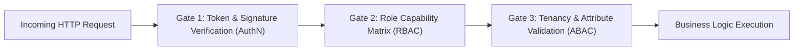

# ZaminFlow Role-Based & Attribute-Based Access Control (RBAC/ABAC) Architecture

**Document ID:** `DOC-ARCH-SEC-001`  
**Classification:** Core Security Architecture  
**Status:** Approved  
**Related ADR:** `ADR-006-hybrid-rbac-abac-data-isolation.md`  

---

## 1. Core Principles & Threat Mitigation

1. **Role Is a Boundary, Not an Authorization:** Role (`FARMER`, `INDUSTRY`, `DRIVER`, `BANK`, `ADMIN`) provides coarse-grained coarse filtering. Fine-grained authorization MUST check tenancy and entity attributes (`ABAC`).
2. **Zero Client Security Reliance:** Frontend conditional rendering (`if (user.role === 'ADMIN')`) is purely a UX optimization. Backend API enforces token verification, role permissions, and tenant ownership on every request.
3. **No Cross-Tenant Data Leaks:** A user can never read, update, or infer data belonging to another organization unless an explicit contractual or logistics assignment links them in the database.
4. **Immutable Audit on Authorization Denial:** Any attempt to access a forbidden resource or modify an unassigned tenant record triggers a high-severity entry in `audit_logs` with client IP, user ID, requested URI, and payload snapshot.

---

## 2. The Hybrid RBAC/ABAC Model

The authorization pipeline consists of three sequential evaluation gates:



### Gate 1: Cryptographic Authentication (AuthN)
- Validates the `Authorization: Bearer <JWT>` header or `access_token` HttpOnly cookie.
- Checks signature against server secret, verifies expiration (`exp`), and ensures the user has not been deactivated in Redis/PostgreSQL session revocation list.

### Gate 2: Coarse-Grained Role Check (RBAC)
- Checks if the user's primary role or assigned scopes permit the action on the resource class.
- *Example:* `POST /api/v1/bank/ledger/export-csv` immediately rejects roles `FARMER`, `INDUSTRY`, and `DRIVER` with HTTP 403 Forbidden.

### Gate 3: Fine-Grained Tenancy & Attribute Check (ABAC)
- Evaluates relationship attributes dynamically against the database before returning or modifying data:
  $$\text{Allow}(u, a, r) \iff \text{RolePermitted}(u.\text{role}, a, r.\text{type}) \land \text{RelationshipMatches}(u, r)$$
- Where $\text{RelationshipMatches}(u, r)$ evaluates:
  - **For Farmer accessing batch $b$:** $b.\text{farmer\_id} = u.\text{organization\_id}$.
  - **For Dairy accessing contract $c$:** $c.\text{buyer\_id} = u.\text{organization\_id}$.
  - **For Driver accessing delivery route $w$:** $w.\text{driver\_id} = u.\text{id} \lor w.\text{vehicle\_id} = u.\text{vehicle\_id}$.
  - **For Bank accessing ledger $l$:** $l.\text{escrow\_account\_id} \in \text{BankMonitoredAccounts}(u.\text{organization\_id})$.
  - **For Admin:** System-wide access, but financial journal writes are strictly blocked (immutable ledger rule).

---

## 3. SQL-Level Tenancy Scoping Examples

Every database repository query enforces tenancy constraints directly in the SQL `WHERE` clause rather than filtering in application memory.

### Farmer Batch Query
```sql
SELECT b.id, b.batch_code, b.volume_liters, b.fat_percentage, b.acidity_titration, b.status
FROM delivery_batches b
WHERE b.farmer_id = :current_user_org_id
ORDER BY b.created_at DESC;
```

### Dairy Inbound Route Query
```sql
SELECT r.id, r.route_code, r.current_status, r.tanker_temperature, r.estimated_arrival
FROM logistics_routes r
JOIN delivery_batches b ON b.route_id = r.id
WHERE b.buyer_id = :current_user_org_id
  AND r.current_status IN ('DISPATCHED', 'IN_TRANSIT', 'APPROACHING')
GROUP BY r.id;
```

---

## 4. Backend Dependency Injection Pattern (FastAPI)

```python
# backend/app/api/deps.py

async def get_current_user_with_role(
    required_roles: list[str],
    current_user: User = Depends(get_current_active_user)
) -> User:
    if current_user.role not in required_roles:
        logger.warning(
            f"RBAC Violation: user={current_user.id} role={current_user.role} "
            f"attempted access requiring={required_roles}"
        )
        raise HTTPException(
            status_code=status.HTTP_403_FORBIDDEN,
            detail="You do not have permission to access this resource"
        )
    return current_user

def require_role(roles: list[str]):
    return Depends(lambda user=Depends(get_current_active_user): get_current_user_with_role(roles, user))
```
