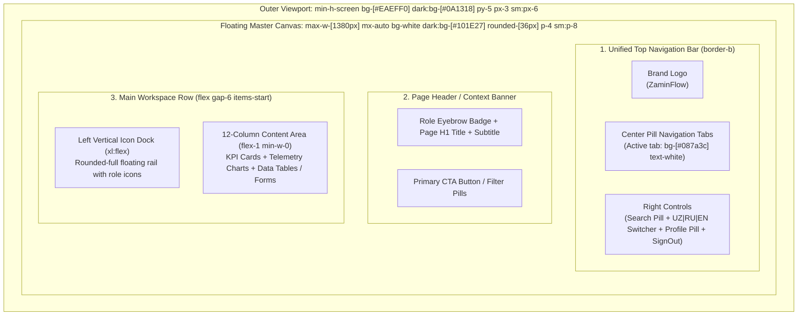

# ZaminFlow Unified Dashboard Architecture, Structure & Mind-Map Specification

**Document ID:** `DOC-DSN-ARCH-MINDMAP-001`  
**Audience:** UI/UX Designers, Frontend Architects, Product Engineers  
**Scope:** Unified Master Shell (`RoleDashboardShell`), Information Architecture, Mind-Map, Design Tokens, and API Data Contracts across all 5 ZaminFlow Role Portals (`Farmer`, `Dairy Industry`, `Driver`, `Partner Bank`, `Admin`).

---

## 1. Executive Summary & Root-Cause of Design Divergence

### 1.1 Observed Visual Problem
- **Overview Pages (`/dashboard/farmer`, `/dashboard/dairy`, `/dashboard/driver`, `/dashboard/bank`, `/dashboard/admin`):**
  Use the **ZaminFlow Floating Master Canvas** design:
  - Outer viewport background: `#EAEFF0` (Light) / `#0A1318` (Dark)
  - Floating master container: `max-w-[1380px]`, `rounded-[36px]`, `#FFFFFF` (Light) / `#101E27` (Dark)
  - Unified Top Header: Brand Logo + Center Pill Navigation Tabs + Search Pill + `UZ | RU | EN` Language Switcher + User Avatar Profile Link + Sign-Out Icon Button
  - Left Vertical Floating Icon Dock (`aside`) alongside the 12-column responsive content grid
- **Secondary Sub-Pages (e.g., `/dashboard/farmer/my-milk`, `/deliveries`, `/payouts`, `/dispute`, `/list-supply`, etc.):**
  Previously used a standalone legacy template (`bg-[linear-gradient(160deg,#f6f9f8_0%,#e4f6ec_100%)]`) with a different white pill navbar, missing the `Arbitration` and `Profile` tabs, missing the `UZ | RU | EN` language switcher, missing the Left Vertical Icon Dock, and lacking Dark Mode (`dark:`) support.

### 1.2 Architectural Solution: `<RoleDashboardShell />`
Every route under `/dashboard/{role}/*` must render inside a single shared **`RoleDashboardShell`** layout component so that:
1. The **Floating Master Canvas**, **Top Navigation Bar**, **Language Switcher**, **User Profile Pill**, and **Left Vertical Icon Dock** never jump, disappear, or change theme when navigating between tabs.
2. Only the inner `<main>` workspace area transitions between views (`Overview`, `My Milk`, `Deliveries`, `Payouts`, `Arbitration`, `Profile`, etc.).
3. Both **Light Mode** (Coolors Emerald Palette `#d8f3dc` $\to$ `#081c15`) and **Dark Mode** (`#0A1318` / `#101E27` / `#22d36b`) work identically on every page.

---

## 2. Master Dashboard Mind-Map (Information Architecture)

```mermaid
flowchart TD
    Root["ZaminFlow Role-Based Dashboard Ecosystem (/dashboard)"]

    Root --> Shell["Unified Master Shell (RoleDashboardShell.tsx)"]
    Shell --> TopBar["1. Top Navigation Bar (Logo + Pill Tabs + Search + UZ/RU/EN + Profile + SignOut)"]
    Shell --> LeftDock["2. Left Vertical Icon Dock (Quick Role Navigation + SignOut)"]
    Shell --> Canvas["3. 12-Column Adaptive Workspace Grid (Light & Dark Mode)"]

    Root --> Farmer["🌾 Farmer Portal (/dashboard/farmer)"]
    Root --> Dairy["🏭 Dairy Industry Buyer Portal (/dashboard/dairy)"]
    Root --> Driver["🚛 Cold-Chain Driver Portal (/dashboard/driver)"]
    Root --> Bank["🏦 Partner Bank Custodian Portal (/dashboard/bank)"]
    Root --> Admin["🛡️ Platform Admin Governance Portal (/dashboard/admin)"]

    %% Farmer Nodes
    Farmer --> F_Over["Overview (/dashboard/farmer)\nKPIs: Next Payout, Monthly Yield, Quality Grade, Recent Batches"]
    Farmer --> F_Milk["My Milk Inventory (/dashboard/farmer/my-milk)\nCold Storage Volume, Bulk Tank Temp, Batch Filter"]
    Farmer --> F_List["List Milk Supply (/dashboard/farmer/list-supply)\nPOST /api/v1/farmer/supply (Volume, Temp, Fat/SNF/°T)"]
    Farmer --> F_Deliv["Deliveries & GPS (/dashboard/farmer/deliveries)\n5-Step Cold-Chain Milestone Stepper"]
    Farmer --> F_Batch["Batch Telemetry Detail (/dashboard/farmer/batches/[id])\nIoT Temp Curve, QR Handover, Lab Certificate"]
    Farmer --> F_Pay["Bank Payouts (/dashboard/farmer/payouts)\nGET /api/v1/farmer/payouts & IBAN Settlement Table"]
    Farmer --> F_Disp["Arbitration & Dispute (/dashboard/farmer/dispute)\nPOST /api/v1/farmer/batches/{id}/dispute (Escrow Freeze)"]
    Farmer --> F_Prof["Farm Trading Profile (/dashboard/farmer/profile)\nKYB Status, Herd Size, Cooling Tank, IBAN"]

    %% Dairy Nodes
    Dairy --> D_Over["Overview (/dashboard/dairy)\nKPIs: Open Orders, Intake Today, Active Fleet, Escrow Vault"]
    Dairy --> D_Ord["Procurement Orders (/dashboard/dairy/orders)\nActive Supply Contracts & Fulfillment Progress"]
    Dairy --> D_Place["Create Order (/dashboard/dairy/place-order)\nGET /api/v1/dairy/catalog & Contract Prefunding"]
    Dairy --> D_Ship["Incoming Shipments (/dashboard/dairy/shipments)\nLive GPS Tanker Fleet & ETA Monitor"]
    Dairy --> D_Rec["Gate Lab Titration (/dashboard/dairy/receive-batch)\nPOST /api/v1/batches/{id}/lab-verify (Fat, SNF, °T, Release)"]
    Dairy --> D_Esc["Escrow Vault (/dashboard/dairy/escrow)\nLocked Reserves, Disbursements & Top-Up"]
    Dairy --> D_Econ["Regional Economics (/dashboard/dairy/regional-pricing)\nUzbekistan Regional Raw Milk Spot Index"]
    Dairy --> D_Prof["Processor Profile (/dashboard/dairy/profile)\nPlant Silo Capacity, Lab Certs, Team Management"]

    %% Driver Nodes
    Driver --> Dr_Over["Overview (/dashboard/driver)\nActive Waybill, Cold-Chain Gauge, Collection Manifest, Offline Badge"]
    Driver --> Dr_Trips["My Trips (/dashboard/driver/my-trips)\nAssigned Tanker Runs & Compartment Loads"]
    Driver --> Dr_Start["Start Trip (/dashboard/driver/start-trip)\nPre-Trip Refrigeration & CIP Sanitation Checklist"]
    Driver --> Dr_Pick["QR Pickup Handover (/dashboard/driver/confirm-pickup)\nPOST /api/v1/driver/telemetry & Offline Queue Sync"]
    Driver --> Dr_Route["GPS Route Map (/dashboard/driver/route)\nWaypoints & Yandex/Google Navigator Deep-Links"]
    Driver --> Dr_Hist["Trip Logbook (/dashboard/driver/history)\nCompleted Runs & On-Time Cold-Chain Score"]
    Driver --> Dr_Issue["Report Incident (/dashboard/driver/report-issue)\nCooling Breakdown / Road Delay Alert"]
    Driver --> Dr_Prof["Driver Profile (/dashboard/driver/profile)\nVehicle Plate, Tanker Capacity, License"]

    %% Bank Nodes
    Bank --> B_Over["Escrow & Clearing Overview (/dashboard/bank)\nKPIs: Custody Held, Released Today, Frozen Disputes, Fee Revenue\nDouble-Entry Ledger Table + ISO 20022 pacs.008 XML & CSV Export"]

    %% Admin Nodes
    Admin --> A_Over["Governance Overview (/dashboard/admin)\nKPIs: Pending KYB, Active Users, Open Disputes, Total Escrow"]
    Admin --> A_Users["Platform Users (/dashboard/admin/users)\nDirectory by Role, KYB Status & Trust Score"]
    Admin --> A_Ver["KYB Verification Queue (/dashboard/admin/verification)\nSoliq.uz TIN & Agrobank IBAN Dossiers"]
    Admin --> A_VerId["KYB Dossier Inspection (/dashboard/admin/verification/[id])\nPOST /api/v1/admin/kyb/{id}/approve or /reject"]
    Admin --> A_Disp["Dispute Arbitration Tribunal (/dashboard/admin/disputes)\nPOST /api/v1/disputes/{batch_id}/resolve (100% / 50-50 / Deduction)"]
    Admin --> A_Prof["Admin Operations Profile (/dashboard/admin/profile)\nSecurity Audit Logs & Governance Controls"]
```

---

## 3. Unified Master Shell Wireframe & Layout Anatomy

All 27 dashboard pages share this exact structural skeleton:

---

## 4. Design System Tokens (Light & Dark Mode)

| Token Purpose | Light Mode Value (Coolors Emerald Palette) | Dark Mode Value (Deep Slate & Emerald) | Tailwind Classes |
| :--- | :--- | :--- | :--- |
| **Outer Viewport Canvas** | `#EAEFF0` | `#0A1318` | `bg-[#EAEFF0] dark:bg-[#0A1318]` |
| **Floating Master Container** | `#FFFFFF` | `#101E27` | `bg-white dark:bg-[#101E27] rounded-[36px] border border-slate-100 dark:border-white/5` |
| **Inner Section / Card Surface** | `#F8FAFC` (`slate-50`) | `rgba(255,255,255,0.05)` | `bg-slate-50 dark:bg-white/5 rounded-[28px] border border-slate-200/70 dark:border-white/10` |
| **Hero FinTech Accent Card** | `#065F46` $\to$ `#022C22` | `#065F46` $\to$ `#022C22` | `bg-gradient-to-br from-[#065F46] via-[#047857] to-[#022c22] text-white` |
| **Primary Brand Action / Active Tab** | `#087A3C` (hover `#065F46`) | `#087A3C` / Accent `#22D36B` | `bg-[#087a3c] hover:bg-[#065F46] text-white` |
| **Primary Heading Text** | `#0F172A` (`slate-900`) | `#FFFFFF` | `text-slate-900 dark:text-white` |
| **Secondary / Muted Text** | `#64748B` (`slate-500`) | `#94A3B8` (`slate-400`) | `text-slate-500 dark:text-slate-400` |
| **Success Status Badge** | `#D8F3DC` bg / `#1B4332` text | `emerald-950/60` bg / `emerald-300` text | `bg-emerald-100 text-emerald-800 dark:bg-emerald-950/60 dark:text-emerald-300` |
| **Warning / Pending Titration Badge** | `#FEF3C7` bg / `#92400E` text | `amber-950/60` bg / `amber-300` text | `bg-amber-100 text-amber-800 dark:bg-amber-950/60 dark:text-amber-300` |
| **Danger / Dispute Frozen Badge** | `#FEE2E2` bg / `#991B1B` text | `red-950/60` bg / `red-300` text | `bg-red-100 text-red-800 dark:bg-red-950/60 dark:text-red-300` |
| **Numeric Telemetry Font** | `JetBrains Mono` (`tabular-nums`) | `JetBrains Mono` (`tabular-nums`) | `font-mono tabular-nums` |

---

## 5. Complete Role-by-Role Navigation & Route Architecture

### 5.1 Farmer Portal (`/dashboard/farmer/*`)
- **Target Persona:** Smallholder farmer / cooperative manager (mobile-first & desktop responsive).
- **Top Pill Tabs & Left Dock Items:**
  1. `Overview` (`/dashboard/farmer`) — Next Payout FinTech card, Daily Milk Yield bar chart, Certified Quality Grade ring, Recent Deliveries, Bank Payouts.
  2. `My milk` (`/dashboard/farmer/my-milk`) — Cold storage inventory KPIs, status filter pills, batch cards with Fat/SNF/°T and `+ List new milk supply` CTA (`/dashboard/farmer/list-supply`).
  3. `Deliveries` (`/dashboard/farmer/deliveries`) — 5-step cold-chain transit stepper (`Dispatched` $\to$ `Farm Handover` $\to$ `GPS Cold Transit` $\to$ `Lab Titration` $\to$ `Bank Payout`) + Batch Telemetry view (`/dashboard/farmer/batches/[id]`).
  4. `Payouts` (`/dashboard/farmer/payouts`) — Settled vs. Locked escrow KPIs, linked Agrobank IBAN card, itemized batch payout calculation table, XLSX tax statement export.
  5. `Arbitration` (`/dashboard/farmer/dispute`) — Lab variance comparison (Farm Handover vs. Plant Receiving Lab), dispute grounds selector, 100% Escrow Freeze submission (`POST /api/v1/farmer/batches/{id}/dispute`).
  6. `Profile` (`/dashboard/farmer/profile`) — Verified KYB badge, cattle headcount, cooling tank capacity, Soliq.uz TIN, and bank IBAN.

### 5.2 Dairy Industry Buyer Portal (`/dashboard/dairy/*`)
- **Target Persona:** Commercial dairy procurement specialist & receiving lab chemist.
- **Top Pill Tabs & Left Dock Items:**
  1. `Overview` (`/dashboard/dairy`) — Escrow Vault card, Daily Plant Intake chart, Cold-Chain Fleet status, Incoming Shipments table, Regional Milk Prices.
  2. `Orders` (`/dashboard/dairy/orders`) — Active procurement orders pipeline, fulfillment progress bars, and `+ Create procurement order` CTA (`/dashboard/dairy/place-order`).
  3. `Shipments` (`/dashboard/dairy/shipments`) — Live GPS tanker fleet monitor, manifold temperature telemetry, and `Gate Lab Intake` CTA (`/dashboard/dairy/receive-batch`).
  4. `Escrow` (`/dashboard/dairy/escrow`) — Prefunded bank vault balance, locked order allocations, automated farmer releases.
  5. `Economics` (`/dashboard/dairy/regional-pricing`) — Regional spot price index across Andijan, Samarqand, Fergana, Namangan, and Tashkent.
  6. `Profile` (`/dashboard/dairy/profile`) — Processing plant silo capacity, lab certifications, and staff/driver team management.

### 5.3 Cold-Chain Driver Portal (`/dashboard/driver/*`)
- **Target Persona:** Refrigerated milk tanker driver operating outdoors and in low-connectivity rural zones.
- **Data Isolation Rule:** Zero exposure to milk prices, contract valuations, or bank escrow amounts.
- **Top Pill Tabs, Left Dock & Mobile Bottom Bar:**
  1. `Overview` (`/dashboard/driver`) — Current Waybill progress card, Weekly Trips chart, Cold-Chain Tanker temperature lock, Today's Collection Stops, Offline Queue sync indicator, Yandex Navigator deep-link.
  2. `My trips` (`/dashboard/driver/my-trips`) — Assigned route manifests, compartment capacities, and `Start Trip` pre-check (`/dashboard/driver/start-trip`).
  3. `QR Pickup` (`/dashboard/driver/confirm-pickup`) — Pump flow meter (L), handover temperature (°C), anti-tamper seal, Farmer 4-digit OTP, and offline store-and-forward queue (`ADR-007`).
  4. `Route` (`/dashboard/driver/route`) — GPS collection waypoints and dairy plant receiving bay coordinates.
  5. `History` (`/dashboard/driver/history`) — Completed trip logbook and cold-chain compliance rating.
  6. `Profile` (`/dashboard/driver/profile`) — Assigned MAN/KamAZ tanker plate, insulated capacity, and driver credentials.

### 5.4 Partner Bank Custodian Portal (`/dashboard/bank`)
- **Target Persona:** Commercial bank escrow & compliance officer (`Agrobank ATB`).
- **Data Isolation Rule:** Strictly scoped to contracts where `c.partner_bank_id = current_user.organization_id`.
- **Workspace Modules:**
  1. `Escrow & Clearing Overview` (`/dashboard/bank`) — Total Escrow Custody Held, Settled & Released Today, Dispute-Frozen Batches, Custody & Factoring Revenue, Double-Entry Financial Ledger table, and **ISO 20022 `pacs.008.001.08` XML** (`X-ISO20022-SHA256`) & CSV exports.

### 5.5 Platform Admin Governance Portal (`/dashboard/admin/*`)
- **Target Persona:** ZaminFlow compliance, KYB verification, and arbitration tribunal operator.
- **Top Pill Tabs & Left Dock Items:**
  1. `Overview` (`/dashboard/admin`) — Total Platform Escrow card, Weekly Onboarding velocity, Dispute Tribunal status, KYB Verification Priority Queue, Users by Role distribution.
  2. `Users` (`/dashboard/admin/users`) — Platform organization & user registry with role filters and KYB status badges.
  3. `Verification` (`/dashboard/admin/verification` & `/dashboard/admin/verification/[id]`) — Soliq.uz TIN & Agrobank IBAN KYB dossiers with `Approve` / `Reject` actions.
  4. `Disputes` (`/dashboard/admin/disputes`) — Frozen batch arbitration tribunal with 3 deterministic rulings (`100% Farmer Release`, `50/50 Split`, `Uphold Dairy Deduction`).
  5. `Profile` (`/dashboard/admin/profile`) — Immutable security audit log explorer (`/api/v1/admin/audit-logs`) and operator profile.
