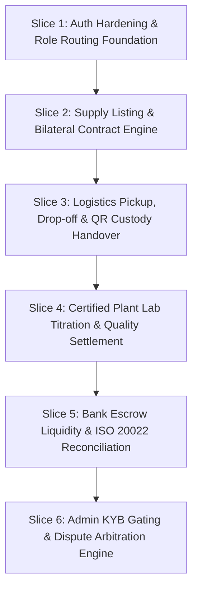

# ZaminFlow Product Roadmap & Release Slices

**Document ID:** `DOC-PLN-RDS-001`  
**Methodology:** MoSCoW Prioritization & Thin Vertical End-to-End Slices  
**Target Milestone:** Launch Candidate 1.0 (Commercial Production Deployment)  

---

## 1. MoSCoW Feature Categorization

### Must-Have (Launch Blockers — Required for Day 1 Operations)
1. **Role-Based Authentication & Hardened Middleware:**
   - Server-signed JWT validation, revocation checking, zero client cookie spoofing.
   - Dedicated routes: `/dashboard/farmer`, `/dashboard/dairy`, `/dashboard/driver`, `/dashboard/bank`, `/dashboard/admin`.
2. **Farmer Daily Supply Listing & Batch Lifecycle:**
   - Farmer enters volume (L), session (Morning/Evening), and cooling tank temp (°C).
   - Real-time farm-gate price calculation and batch status tracking.
3. **Dairy Bilateral Supply Contract Engine:**
   - Contract creation with baseline UZS/L, base fat % (3.6%), base SNF % (8.5%), and step premium/penalty rules.
   - Contract acceptance by farmer cooperative.
4. **Logistics Route Handover (Driver App):**
   - Driver route stops, QR pickup confirmation at farm gate, and QR intake drop-off at plant bay.
   - High-contrast outdoor mode with basic offline PWA cache.
5. **Certified Plant Lab Titration & Settlement Engine:**
   - Lab chemist enters gross volume, fat %, SNF %, acidity °T, antibiotic test.
   - Automated quality price calculation and immutable ledger posting.
6. **Bank Escrow & Ledger Overview:**
   - Live escrow reserve monitoring, transaction journal audit, and ISO 20022 clearing export.
7. **Admin KYB Approval & Quality Dispute Arbitration:**
   - Organization verification portal and titration dispute docket resolution.

### Should-Have (Release 1.1 — Fast Follow within 30 Days of Launch)
1. Automated background GPS breadcrumb streaming with adaptive sampling.
2. In-app Push Notifications for farmer pickup arrival alerts (< 30 minutes away).
3. 1C Enterprise XML accounting export module for dairy plant ERP integration.
4. Multilingual voice notes for illiterate smallholders to report volume.

### Could-Have (Release 1.2 — Quarter 2)
1. Advanced factoring and pre-harvest feed micro-loans linked to historical delivery reliability.
2. Hardware IoT integration with automatic tanker flow meter and Bluetooth digital refractometers.
3. AI-driven milk supply forecasting based on seasonal calving and weather models.

### Won't-Have (Deliberately Excluded from Launch Scope)
1. Public bidding / Dutch auctions (unsuited for perishable raw milk with bilateral supply agreements).
2. Unregulated peer-to-peer consumer lending.
3. Speculative futures trading of agricultural commodities.

---

## 2. Thin Vertical Release Slices (Implementation Sequence)

### Vertical Slice 1: Authentication Hardening & Role Routing Foundation
- **Scope:** Purge client-side cookie spoofing in `frontend/src/middleware.ts`; enforce server JWT verification; implement layout shells for `/dashboard/farmer`, `/dairy`, `/driver`, `/bank`, `/admin` with zero mock data.
- **Verification Criteria:** Pytest integration tests verify that an unauthenticated user or unauthorized role receives strict HTTP 401/403. Frontend test verifies redirection.

### Vertical Slice 2: Supply Listing & Bilateral Contract Engine
- **Scope:** Connect Farmer supply listing UI to `/api/v1/farmer/batches`; connect Dairy procurement UI to `/api/v1/contracts`; implement bilateral quality pricing rule formula.
- **Verification Criteria:** Farmer lists 1,500 L; Buyer sees batch in catalog and initiates contract; Farmer accepts contract; state transitions from `DRAFT` to `ACTIVE`.

### Vertical Slice 3: Logistics Pickup, Drop-off & QR Custody Handover
- **Scope:** Implement driver waypoint execution view; QR generator for farmer; QR scanner for driver; offline IndexedDB store for pickup signatures.
- **Verification Criteria:** Driver scans farmer QR in offline mode; record saved locally; network restored; record auto-synced to PostgreSQL `delivery_batches` with status `IN_TRANSIT`.

### Vertical Slice 4: Certified Plant Lab Titration & Quality Settlement
- **Scope:** Dairy plant lab intake form (`/dairy/intake`); execute deterministic price calculation; generate automated financial ledger entry (`financial_ledger`).
- **Verification Criteria:** Lab technician inputs Fat 4.1%, SNF 8.7%, Acidity 16.5°T; system calculates exact premium; batch status updates to `SETTLED`; escrow dispatches release command.

### Vertical Slice 5: Bank Escrow Liquidity & ISO 20022 Reconciliation
- **Scope:** Bank dashboard UI (`/dashboard/bank`); wire to `/api/v1/bank/dashboard-kpis` and `/api/v1/bank/ledger`; implement ISO 20022 `pacs.008` XML exporter.
- **Verification Criteria:** Bank user views aggregate escrow reserves; clicks export; valid XML matching Central Bank schema is generated with SHA-256 hash.

### Vertical Slice 6: Admin KYB Gating & Dispute Arbitration Engine
- **Scope:** Admin approval portal for pending organizations; arbitration docket for divergent titration reports (`/admin/disputes`).
- **Verification Criteria:** Admin approves farmer KYB; farmer status changes to `ACTIVE`; Admin arbitrates a frozen dispute, triggering calibrated payout split.
